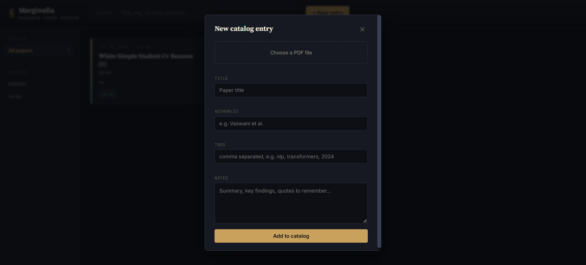

# Marginalia: Research Paper Organizer

A full-stack MERN application for students and researchers to upload, tag, annotate, and search academic papers. Styled as a dark "reading room" archive: index-card style entries, brass and moss accents, serif titles.

**Live demo:** https://research-paper-organizer.vercel.app
(The backend runs on Render's free tier, so the first request may take 30-60 seconds to wake up.)

## Screenshots




## Features

- **Upload PDFs** with title, author, tags, and notes
- **Full-text search** across titles, tags, and note contents (MongoDB text index)
- **Tag catalog**: filter papers by subject from the sidebar
- **Notes editor**: attach and edit research notes per paper at any time
- **Card-based archive view** styled like a library index card catalog

## Tech Stack

- **Frontend**: React (custom CSS design system, no UI library)
- **Backend**: Node.js, Express
- **Database**: MongoDB (Atlas free tier recommended) + Mongoose
- **File Upload**: Multer
- **PDF Parsing**: pdf-parse (used to index PDF content for search)
- **Deployment**: Vercel (frontend), Render (backend)

## Prerequisites

- Node.js v18+
- A free MongoDB Atlas cluster: https://www.mongodb.com/cloud/atlas/register

## Setup

### 1. Get a MongoDB connection string

1. Create a free cluster on MongoDB Atlas
2. Click "Connect" → "Drivers" → copy the connection string
3. Replace `<password>` with your database user's password

### 2. Backend

```
cd backend
npm install
cp .env.example .env
```

Edit `.env`:

```
PORT=5000
MONGO_URI=mongodb+srv://<user>:<password>@cluster.mongodb.net/marginalia?retryWrites=true&w=majority
```

Run:

```
npm start
```

You should see `MongoDB connected` and `Server running on http://localhost:5000`.

### 3. Frontend

```
cd frontend
npm install
npm start
```

Opens automatically at `http://localhost:3000`.

## Project Structure

```
research-paper-organizer/
├── backend/
│   ├── server.js
│   ├── config/db.js              # MongoDB connection
│   ├── models/Paper.js           # Mongoose schema + text index
│   ├── routes/papers.js          # Upload, list, search, update, delete
│   ├── utils/extractPdfText.js   # PDF text extraction for search
│   └── uploads/                  # Stored PDF files
├── frontend/
│   ├── src/
│   │   ├── App.js
│   │   ├── App.css               # Design system (dark academic theme)
│   │   ├── api.js                # API client
│   │   └── components/
│   │       ├── Sidebar.jsx       # Tag catalog
│   │       ├── PaperCard.jsx     # Index-card style entry
│   │       ├── UploadModal.jsx
│   │       └── DetailDrawer.jsx  # Notes/tags editor + delete
│   └── public/index.html
└── README.md
```

## Deployment (Free)

- **Frontend**: Vercel, root directory `frontend`
- **Backend**: Render, root directory `backend`, add `MONGO_URI` as an environment variable
- **Database**: MongoDB Atlas free tier (M0 cluster)

After deploying the backend, set `REACT_APP_API_URL` in Vercel's environment variables to your Render backend URL.

## Limitations

- Uploaded PDFs are stored on the server's local disk (`backend/uploads/`). On free hosting such as Render this storage is not persistent, so files may be lost after a restart. Cloud storage is planned.
- Search is keyword-based (MongoDB text index), not semantic.
- Only text-based PDFs can be indexed for content search; scanned image PDFs cannot be parsed.

## Future Improvements

- Persistent cloud storage for PDFs (e.g., Cloudinary or S3)
- Semantic search over paper content
- Citation export (BibTeX / APA)

## Author

Amna Shoaib, BS Information Technology, MNS University of Agriculture, Multan, Pakistan  
GitHub: [@amnashoaib2510-cloud](https://github.com/amnashoaib2510-cloud)
